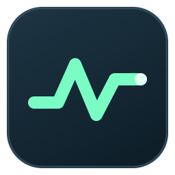
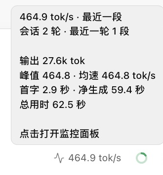
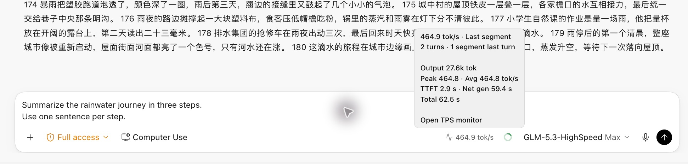
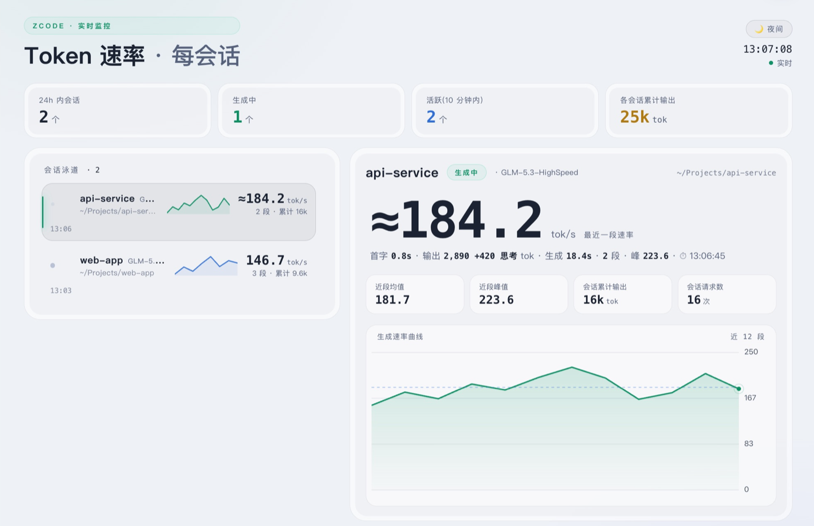
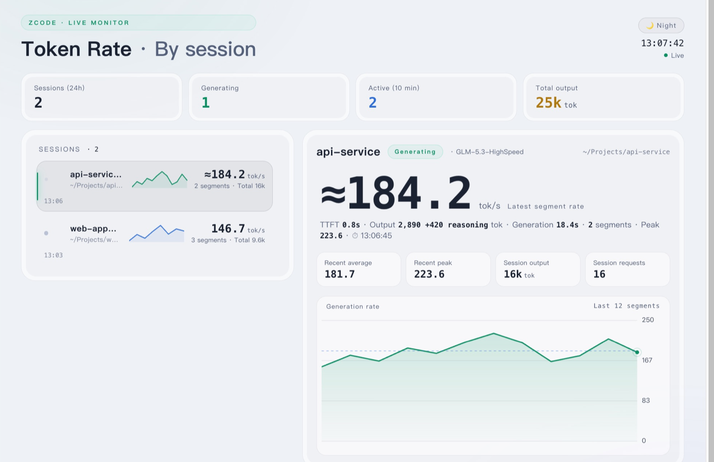

# ZCode TPS Monitor

[简体中文](README.md) · **[English](README.en.md)**

[](https://github.com/shy3130/zcode-tps-monitor/actions/workflows/ci.yml)
[](https://github.com/shy3130/zcode-tps-monitor/releases/latest)
[](LICENSE)

**A session token rate monitor for ZCode Desktop.** See live `tok/s` for the current session at the bottom of the composer. Hover to view turn statistics, or click to open the multi-session dashboard.

[Installation and updates](#installation-and-updates) · [Usage](#usage) · [Rate calculations](#rate-calculations) · [Configuration](#configuration) · [Development and contributing](#development-and-contributing)

## Features

- **Native composer status.** See the estimated rate during generation and the rate of the most recent completed request. Completed rates are saved per session and restored when you switch sessions or restart ZCode.
- **Hover statistics.** View the session's turn count, the number of request segments, time to first token, output and reasoning tokens, peak and average rates, and elapsed times.
- **Multi-session dashboard.** See sessions from the last 24 hours, cumulative usage, and rate charts. Select a session to pin its details, or return to following the latest session. The dashboard supports light and dark themes.
- **Chinese and English.** The tooltip and built-in dashboard follow the ZCode interface language and update immediately when it changes. Choose **System default** in ZCode to follow the operating system language.

## Screenshots

| Chinese tooltip | English tooltip |
| --- | --- |
|  |  |

| Chinese dashboard | English dashboard |
| --- | --- |
| [](assets/tps-dashboard-zh.png) | [](assets/tps-dashboard-en.png) |

The dashboard screenshots use demo data. Click an image to enlarge it.

## Installation and updates

### Requirements

- **ZCode Desktop 3.18.2 or later**.
- The CLI, hooks, and MCP server use Node.js on your `PATH`. **Node.js 22.13 or later** is recommended for direct access to `node:sqlite`. [Node.js SQLite documentation](https://nodejs.org/api/sqlite.html)

### Install

Open a workspace in ZCode and run the following commands in a session to install the plugin at user scope.

```text
/plugin marketplace add shy3130/zcode-tps-monitor
/plugin install zcode-tps-monitor@tps-local-marketplace
```

You can also go to **Settings → Plugins → Create → Add marketplace**, enter `shy3130/zcode-tps-monitor`, and install **ZCode TPS Monitor**. [ZCode plugin documentation](https://zcode.z.ai/en/docs/plugin)

### Update

Refresh the GitHub marketplace source, then update the installed plugin.

```text
/plugin marketplace update tps-local-marketplace
/plugin update zcode-tps-monitor@tps-local-marketplace
```

Restart ZCode to load the new version. See [GitHub Releases](https://github.com/shy3130/zcode-tps-monitor/releases) and the [changelog](CHANGELOG.md) for changes.

## Usage

Send a request after installation. The rate appears next to the waveform at the bottom of the composer. A leading `≈` marks a streaming estimate. Hover for statistics, or click the waveform or rate to open the built-in dashboard.

| Action | Command |
| --- | --- |
| View a snapshot of application TPS and system resources | `/tps` |
| Sample application TPS for 10 seconds | `/tps 10` |
| Check Node.js, the usage database, and session state | `/tps-doctor` |
| Open the standalone dashboard in a browser | `/zcode-tps-monitor:dashboard` |

You can also call `/tps` and `/tps-doctor` by their full names, `/zcode-tps-monitor:tps` and `/zcode-tps-monitor:tps-doctor`.

### Rate calculations

| Metric | How it is calculated |
| --- | --- |
| Composer `tok/s` | The request rate reported by ZCode. The plugin shows an estimate during generation and saves the request rate when it completes. |
| Time to first token and net generation | Time to first token measures the delay from the start of the first request segment to its first token. Net generation adds the time from the first token to completion for each segment. Durations under one second are displayed in milliseconds. |
| Total time | Usually measured from the turn's prompt until the last segment completes. Includes the initial wait for the first token and time spent running tools between segments. |
| Peak and average | A segment's rate is its output plus reasoning tokens divided by its net generation time in seconds. The peak is the highest valid segment rate. The average divides the total tokens from valid segments by their combined net generation time. |

Peak and average rates use valid segments with at least **200 ms** of net generation. Shorter segments still contribute to the segment and token counts and to measurable net generation time. The tooltip shows “Sample too short” when there are no valid samples. The composer and tooltip shorten large numbers with `k/M/B` for thousands, millions, and billions. Calculations use the original values.

## Configuration

- **Usage database.** The plugin reads `~/.zcode/cli/db/db.sqlite` in read-only mode by default. Set `ZCODE_USAGE_DB` to use a different database from the CLI.
- **Manual report formatting.** Adjust `statsFormat` in `~/.zcode/tps-monitor.config.json`. [Plugin configuration (Chinese)](plugins/zcode-tps-monitor/README.md#配置)
- **Application TPS.** Set `metrics_url` in the ZCode plugin settings to use a JSON endpoint that reports TPS, latency, and error rates. Leave it blank to use demo data. Agents can get these metrics through the `tps_snapshot` and `tps_watch` MCP tools.

## FAQ

**Why does the composer show `— tok/s`?** The current session has no saved rate. Send a request and the indicator will update when it receives rate data.

**Why does the composer rate differ from the tooltip average?** The composer shows a single request rate. The tooltip average aggregates the segments in the turn that meet the sampling threshold.

**Why is the indicator missing after installation?** Check the ZCode version and make sure the plugin is enabled. Restart ZCode and send a new request. Run `/tps-doctor` to check the environment.

## Development and contributing

```bash
git clone https://github.com/shy3130/zcode-tps-monitor.git
cd zcode-tps-monitor
node --test
```

CI runs the tests on macOS, Windows, and Linux with Node.js 22 and 24. For local debugging, add the repository root as a local directory in the ZCode marketplace. The [plugin development guide (Chinese)](plugins/zcode-tps-monitor/README.md) covers the directory layout, CLI commands, and dashboard debugging.

Issues and pull requests are welcome. Include your ZCode, plugin, and Node.js versions along with steps to reproduce the problem. [Report an issue](https://github.com/shy3130/zcode-tps-monitor/issues)

## License

[MIT](LICENSE) © 2026 shy3130
