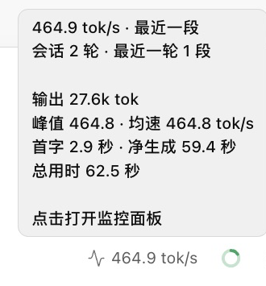
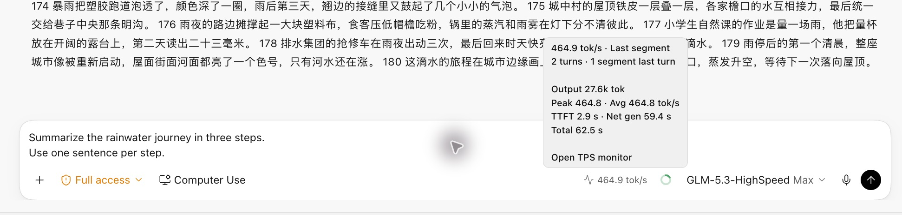
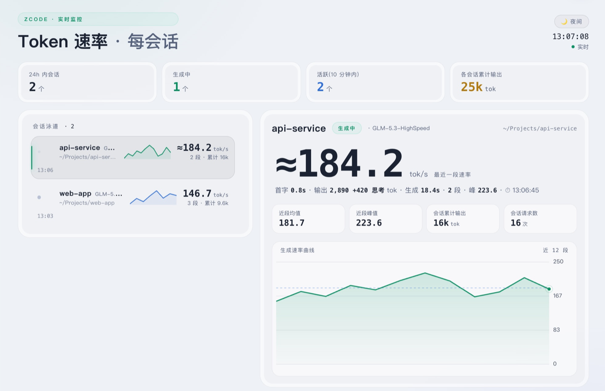
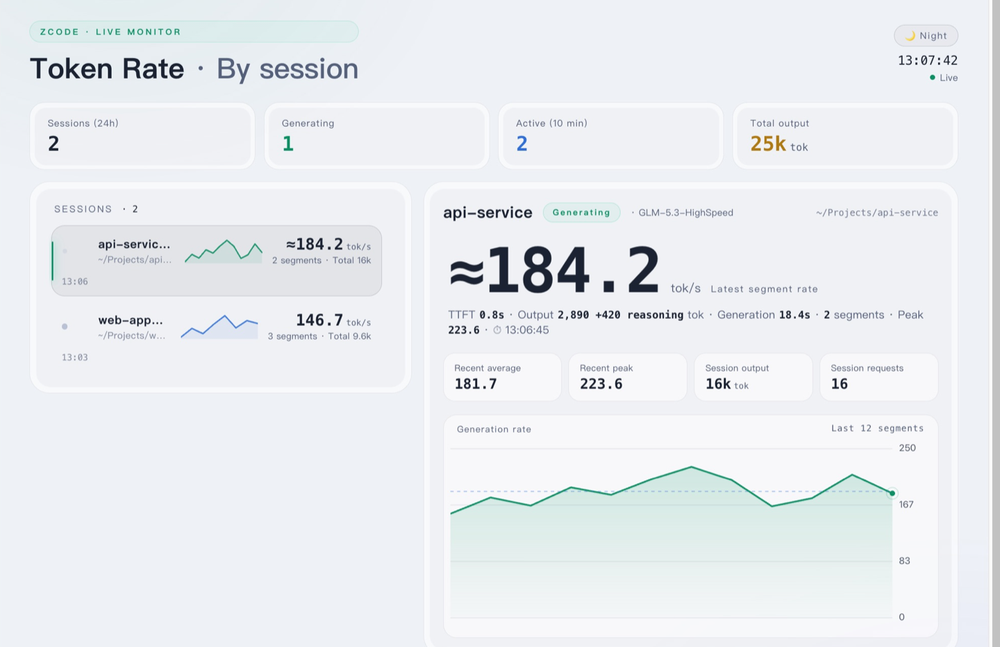

# ZCode TPS Monitor

[](https://github.com/shy3130/zcode-tps-monitor/actions/workflows/ci.yml)
[](https://github.com/shy3130/zcode-tps-monitor/releases/latest)
[](LICENSE)

**ZCode 桌面端的会话 Token 速率监控插件。** 在输入框底部实时查看当前会话的 `tok/s`，悬停查看本轮统计，点击打开多会话监控面板。

[安装与更新](#安装与更新) · [使用](#使用) · [统计口径](#统计口径) · [配置](#配置) · [开发与贡献](#开发与贡献)

## 主要功能

- **原生底栏**显示生成中的速率估算和最近完成的请求速率。完成读数按会话保存，切换会话或重启后自动恢复。
- **悬停统计**展示会话轮数、请求段数、首字延迟、输出与思考 token、峰值、均速和耗时。
- **多会话面板**展示近 24 小时的会话、累计用量和速率曲线。点击会话可锁定详情，也可以恢复跟随最新会话。面板提供日间和夜间主题。
- **中英文界面**覆盖悬停卡片和内置面板，随 ZCode 界面语言即时切换。选择「系统默认」时采用系统语言。

## 效果预览

| 中文悬停卡片 | English tooltip |
| --- | --- |
|  |  |

| 中文监控面板 | English dashboard |
| --- | --- |
| [](assets/tps-dashboard-zh.png) | [](assets/tps-dashboard-en.png) |

监控面板截图使用演示数据。点击图片可放大。

## 安装与更新

### 环境要求

- **ZCode 桌面端 3.18.2 或更高版本**。
- 命令行工具、钩子和 MCP 使用 `PATH` 上的 Node.js。推荐 **Node.js 22.13 或更高版本**，可直接使用 `node:sqlite`。 [Node.js SQLite 文档](https://nodejs.org/api/sqlite.html)

### 安装

打开一个 ZCode 工作区，在会话中按顺序执行以下命令，以用户范围安装。

```text
/plugin marketplace add shy3130/zcode-tps-monitor
/plugin install zcode-tps-monitor@tps-local-marketplace
```

也可以在 **设置 → 插件 → 创建 → 添加插件市场** 中填入 `shy3130/zcode-tps-monitor`，然后安装 **ZCode TPS Monitor**。 [ZCode 插件文档](https://zcode.z.ai/cn/docs/plugin)

### 更新

先刷新 GitHub 市场源，再更新已安装的插件。

```text
/plugin marketplace update tps-local-marketplace
/plugin update zcode-tps-monitor@tps-local-marketplace
```

更新后重启 ZCode 加载新版本。具体变更见 [GitHub Releases](https://github.com/shy3130/zcode-tps-monitor/releases) 和 [CHANGELOG](CHANGELOG.md)。

## 使用

安装后发起一条请求。输入框底部的波形旁会出现速率，`≈` 表示流式估算。悬停查看统计，点击波形或数字打开内置监控面板。

| 操作 | 入口 |
| --- | --- |
| 查看业务 TPS 和系统资源快照 | `/tps` |
| 采样业务 TPS 10 秒 | `/tps 10` |
| 检查 Node.js、用量数据库和会话状态 | `/tps-doctor` |
| 在浏览器中打开独立大屏 | `/zcode-tps-monitor:dashboard` |

`/tps` 和 `/tps-doctor` 也可用完整名称 `/zcode-tps-monitor:tps` 和 `/zcode-tps-monitor:tps-doctor` 调用。

### 统计口径

| 字段 | 计算方式 |
| --- | --- |
| 底栏 `tok/s` | ZCode 上报的单次请求速率。生成中显示估算，完成后保存该请求的读数。 |
| 首字与净生成 | 首字是第一段请求到首个 token 的延迟。净生成按各段从首个 token 到完成的时间加总，不足 1 秒时以毫秒显示。 |
| 总用时 | 通常从本轮提问到最后一段完成，包含首字等待和段间工具执行时间。 |
| 峰值与均速 | 单段速率以输出和思考 token 之和除以净生成秒数。峰值取有效段最高速率，均速以有效段的 token 总数除以这些段的净生成时间总和。 |

峰值和均速只使用净生成至少 **200 ms** 的有效样本。较短的段仍计入段数、token 数和可计时的净生成耗时。没有有效样本时显示「样本过短」。底栏和卡片用 `k/M/B`（千、百万、十亿）缩写大数，计算使用原始数据。

## 配置

- **用量数据库**默认读取 `~/.zcode/cli/db/db.sqlite`。插件以只读方式查询，CLI 可通过 `ZCODE_USAGE_DB` 指定其他路径。
- **手动查询样式**可在 `~/.zcode/tps-monitor.config.json` 的 `statsFormat` 中调整。参数见[插件配置文档](plugins/zcode-tps-monitor/README.md#配置)。
- **业务 TPS**可在 ZCode 插件设置中填写 `metrics_url`，接入返回 TPS、延迟和错误率的 JSON 接口。留空使用演示数据。Agent 可通过 MCP 工具 `tps_snapshot` 和 `tps_watch` 取数。

## 常见问题

**为什么底栏是 `— tok/s`？** 当前会话还没有保存的速率。发起一次生成，底栏会在收到速率数据后更新。

**为什么底栏和悬停均速不同？** 底栏显示单次请求的速率。悬停均速把该轮中符合门槛的多段请求汇总计算。

**安装后没有显示底栏？** 检查 ZCode 版本和插件是否已启用，重启后新发一条消息。可运行 `/tps-doctor` 检查环境。

## 开发与贡献

```bash
git clone https://github.com/shy3130/zcode-tps-monitor.git
cd zcode-tps-monitor
node --test
```

CI 使用 Node.js 22 和 24，在 macOS、Windows 和 Linux 上运行测试。可在 ZCode 插件市场中以本地目录添加仓库根目录来调试。目录结构、CLI 用法和面板调试见[插件开发文档](plugins/zcode-tps-monitor/README.md)。

欢迎提交 Issue 和 Pull Request。报告问题时请附上 ZCode、插件和 Node.js 版本，以及复现步骤。 [问题反馈](https://github.com/shy3130/zcode-tps-monitor/issues)

## 许可证

[MIT](LICENSE) © 2026 shy3130
