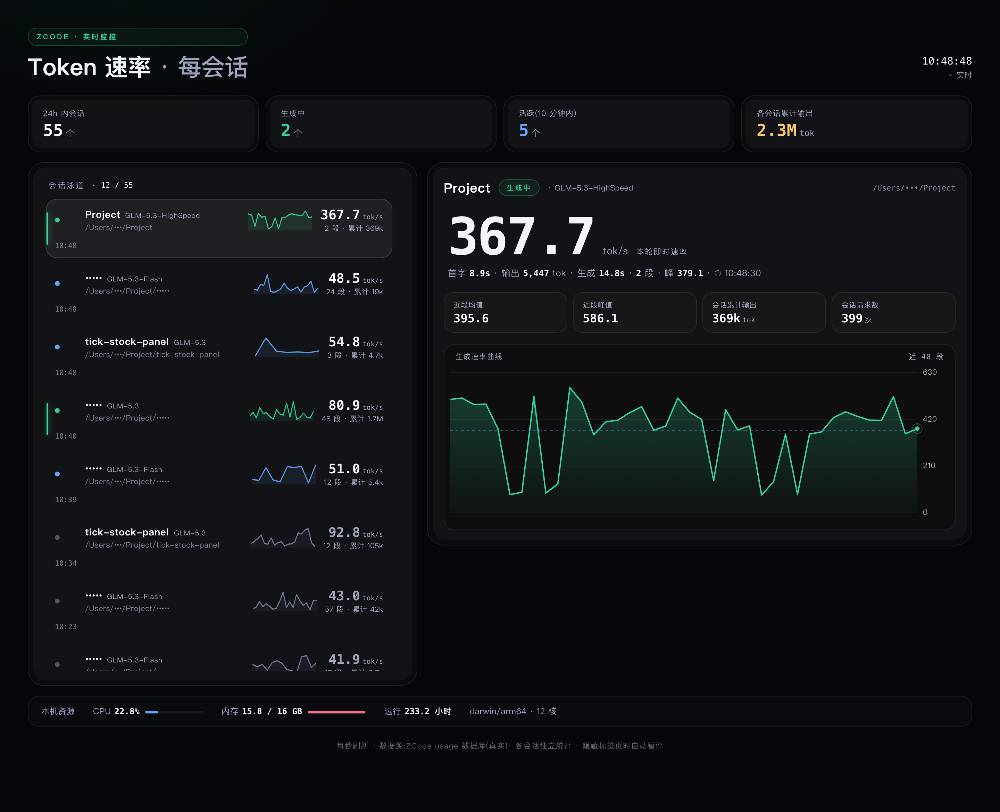

# zcode-tps-monitor

[](LICENSE)


**ZCode 会话级 Token 速率监控插件。** 安装并启用后，输入框底部自动显示当前会话的 tok/s。支持 ZCode 桌面端 **3.18.2 及以上版本**。另提供多会话实时大屏、全会话总览、MCP 工具和可选的业务 TPS 监控。

> 本仓库同时是一个 ZCode 本地插件市场(marketplace 名称:`tps-local-marketplace`),插件本体位于 [`plugins/zcode-tps-monitor/`](plugins/zcode-tps-monitor/README.md)。

## 效果预览

### ① 输入框底栏

上下文用量圆环左边会显示当前会话的速率，例如 `128.4 tok/s`。生成中的估算值带 `≈`，请求完成后显示并保存实际值。切换会话时，数字随当前会话切换。没有测量记录的会话显示 `— tok/s`。

悬停在波形图标或速率数字上可查看会话总轮数、请求段数、首字延迟、输出和思考 token、峰值、均速及耗时。会话轮数按用户提问计数。点击打开多会话监控面板。

悬停的峰值和均速只统计净生成至少 200 毫秒的请求。短段仍计入段数、输出和净生成；净生成不足 1 秒时按毫秒显示。

| 字段 | 含义 |
|---|---|
| `⚡ 71.2 tok/s` | 本问即时速率(含思考 token;多段轮次为"总产出 / 总纯生成时长"的加权值) |
| `首字 9.9s` | 首 token 延迟(TTFT,本问第一段) |
| `4 段` | 本轮请求段数(单段轮次不显示) |
| `输出 15,150 tok · 峰 108.1` | 本问输出 token 数(千分位)与单段峰值速率 |
| `累计 273k` | 会话终身累计输出(紧凑单位:1.9k / 51k / 1.2M) |
| `净 3m26s / 总 2m32s` | 净 = 各段纯生成时长之和;总 = 提问到最后的墙钟(含工具等待);秒/分/时自动换算 |
| `⏱ 09:50:45` | 采样时刻 |

手动查询的包裹样式、分隔符、走势条和时钟可配置(见[配置](#配置统计行样式可选))。

### ② 多会话实时大屏(一个标签页看全部会话)

`/zcode-tps-monitor:dashboard` 一键拉起。**每个会话一条泳道**(生成中 / 活跃 / 空闲三态、迷你走势、即时速率、终身累计),点击聚焦任一会话查看详情与全量速率曲线;秒级刷新,隐藏标签页自动暂停:



### ③ 全会话总览(命令行)

```text
$ node plugins/zcode-tps-monitor/scripts/token-rate.mjs --sessions
● Project  本轮 66.6 tok/s(9 段) · 累计 145k tok · 生成中 · /Users/shy/Project · 21:22:19
● tick-stock-panel  本轮 75.4 tok/s(10 段) · 累计 91k tok · 生成中 · /Users/shy/Project/tick-stock-panel · 21:12:29
· wshy-lab  本轮 361.4 tok/s(10 段) · 累计 1.1M tok · 空闲 · /Users/shy/Project/wshy-lab · 18:16:53
```

## 功能特性

- **会话速率底栏** —— 使用 ZCode 原生输入框状态位，按会话显示并恢复最近一次完成请求的速率
- **多会话实时大屏** —— 每会话一条泳道 + 聚焦详情,增量缓存稳态查询 23–37ms,空闲 3 小时自动退出
- **全会话总览** —— `--sessions` 一行一会话,亦集成于 `/tps` 命令
- **斜杠命令** —— `/tps` 即时快照;`/tps 10` 采样观察;`/tps-doctor` 环境自检
- **MCP 工具** —— `tps_snapshot` / `tps_watch`,供 agent 程序化取数
- **桌面悬浮窗(可选)** —— macOS 置顶常驻小窗 / Windows 文字悬浮条
- **业务 TPS 监控(可选)** —— 配置 `metrics_url` 接入真实业务指标接口,或使用内置演示数据

## 安装

需要 ZCode 桌面端 3.18.2 或更高版本。请以用户范围启用插件。

### 方式一:从 GitHub 添加(推荐)

在 ZCode 中执行:

```text
/plugin marketplace add shy3130/zcode-tps-monitor
/plugin install zcode-tps-monitor@tps-local-marketplace
```

### 方式二:本地目录

克隆本仓库后,在 ZCode 中打开 **设置 → 插件管理 → 发现 → +**,来源选择"本地目录",指向仓库根目录即可。

### 更新

```text
/plugin marketplace update tps-local-marketplace
```

更新插件后，输入框速率随扩展自动加载。

## 使用

| 场景 | 操作 |
|---|---|
| 查看当前会话速率 | 看输入框底部的 tok/s |
| 即时快照 | `/tps`;`/tps 10` 持续采样 10 秒 |
| 全会话总览 | `/tps` 说明词里带"各会话/哪些在跑"即触发 `--sessions`;或直接运行 `node (插件目录)/scripts/token-rate.mjs --sessions` |
| 打开监控面板 | 点击底栏 tok/s，在 ZCode 右侧打开监控；也可用 `/zcode-tps-monitor:dashboard` 打开独立大屏 |
| 环境自检 | 速率不见了?`/tps-doctor` 逐项排查 |
| agent 取数 | MCP 工具 `tps_snapshot` / `tps_watch` |

要求 Node ≥ 22.5(需内置 `node:sqlite`,Windows / macOS / Linux 相同)。

## 配置:统计行样式(可选)

`~/.zcode/tps-monitor.config.json`:

```json
{
  "statsFormat": {
    "wrap": "quote",
    "sep": "dot",
    "clock": true,
    "spark": true,
    "sparkMax": 4
  }
}
```

- **`statsFormat`(微调单行,默认即引用块)**:
  - `wrap`:`quote` 引用块(默认,速率加粗)/ `code` 行内代码胶囊(等宽 + 底色,不加粗)/ `plain` 裸行 / `italic` 斜体
  - `sep`:`dot` 中点 `·`(默认)/ `bar` 竖线 `│`
  - `clock`:行尾 ⏱ 时刻开关
  - `spark`:桌面卡片走势条开关(默认开);`sparkMax` 限段数(1–8,默认 4)

下一次执行手动查询时采用新配置。

## 配置:接入业务 TPS(可选)

插件默认提供演示数据;若要监控真实业务吞吐,在 **设置 → 插件管理 → zcode-tps-monitor** 中配置 `metrics_url`,指向任意返回 JSON 的指标接口。字段自动兼容(支持最多三层嵌套):

| 指标 | 识别的字段名 |
|---|---|
| 吞吐 | `tps` / `qps` / `throughput` / `transactionsPerSecond` |
| 延迟 | `p50` / `p95` / `p99`(或 `latency_p50` 等) |
| 错误率 | `error_rate` / `errorRate` / `err_rate` |

示例接口返回:

```json
{"data":{"tps":1240,"p50":11,"p95":28,"p99":46,"error_rate":0.05}}
```

## 工作原理

- 原生扩展订阅 ZCode 的 `models.onDidGenerate`，按会话更新 `composer.status`。已完成的速率保存在插件数据目录，下次启动或切回会话时恢复。
- SessionStart、UserPromptSubmit 和 Stop 钩子记录会话状态。手动查询和大屏读取 ZCode usage 数据库，`--current` 可按提问时间筛选本轮数据。
- 多会话查询按窗口枚举会话，并增量读取新增的用量记录。
- 业务 TPS 数据取自 `metrics_url` 或内置演示数据。

## 常见问题

**Q:可以在 OpenCode / Codex / Claude Code 等其他工具中使用吗?**

A:插件机制、钩子与数据源均绑定 ZCode,token 速率功能是 ZCode 专属;业务 TPS 采集脚本与大屏是独立程序,可脱离 ZCode 运行,但离开 ZCode 没有速率数据来源。

**Q:底栏和手动查询的数字为什么不同?**

A:底栏使用 ZCode 提供的请求级速率，生成中显示估算值。手动查询和大屏可以按整轮汇总多段请求，因此取样范围可能不同。

**Q:底栏为什么显示 — tok/s?**

A:这个会话还没有可恢复的速率。下一次生成时会自动更新。

**Q:macOS / Linux 支持吗?**

A:支持。钩子、命令、大屏、MCP 均为跨平台 Node 实现;usage 数据库路径按主目录自动解析(`ZCODE_USAGE_DB` 可覆盖)。桌面悬浮:macOS `bash dashboard/overlay/start-macos.sh`(首次自动编译,需 Xcode CLT);Windows `overlay.ps1`;Linux 用大屏即可。

**Q:演示数据怎么关掉?**

A:演示数据只影响"业务 TPS"部分(Token 速率始终真实);不配置 `metrics_url` 即为演示模式,配置后自动切换。

## License

[MIT](LICENSE) © 2026 shy3130
