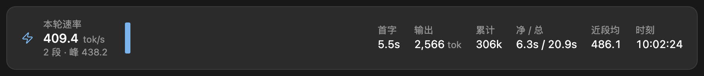
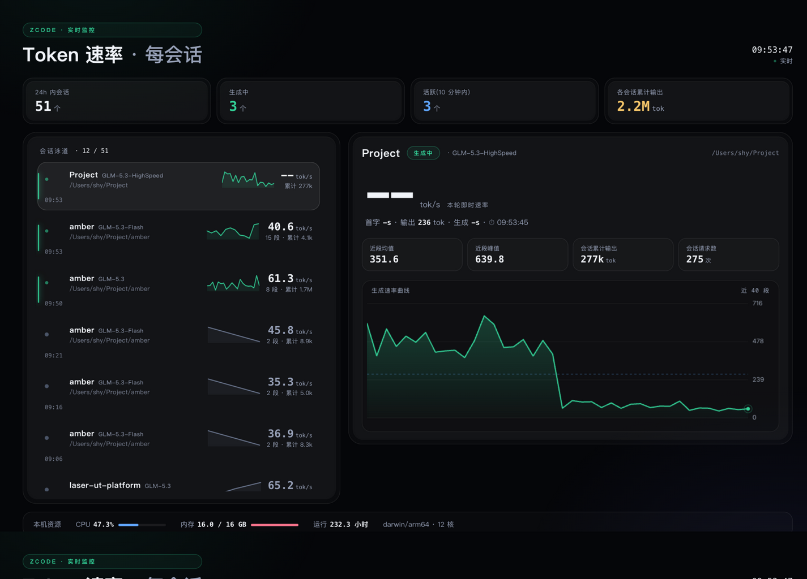
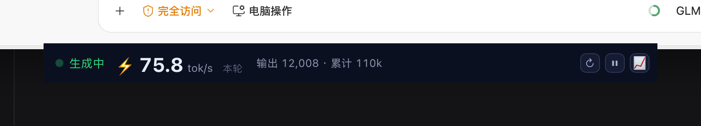

# zcode-tps-monitor

项目介绍、安装与使用说明见[仓库首页 README](../../README.md)。本文件面向插件内部结构与开发测试。

## 效果预览

**① 回复结尾统计 · 手机/网页/CLI**(代码风单行,自动;整行包反引号渲染为代码胶囊):

```text
⚡ 71.2 tok/s ▂██▁ · 首字 9.9s · 输出 15,150 tok · 峰 108.1 · 累计 273k · 净 3m26s / 总 2m32s · ⏱ 09:50:45
```

**① 回复结尾统计 · 桌面端**(Gen UI 卡片,自动;一条命令静默落盘):



**② 多会话实时大屏**(每会话一条泳道,点击聚焦详情):



**③ 桌面悬浮窗(可选)**:macOS 置顶小窗(常规/单行两种形态)、Windows 文字悬浮条:

| macOS 常驻小窗 | macOS 单行模式(`?style=line`) |
|---|---|
|  |  |

## 配置

全部配置写 `~/.zcode/tps-monitor.config.json`(改完下一轮即生效,无需重装):

```json
{
  "tokenRateLine": true,
  "statsStyle": "card",
  "statsFormat": {
    "wrap": "code",
    "sep": "bar",
    "clock": true,
    "spark": true,
    "sparkMax": 4
  },
  "stopHookLine": false
}
```

| 键 | 取值 | 说明 |
|---|---|---|
| `tokenRateLine` | `true` / `false` | 总开关:`false` 关闭全部速率注入(含收尾统计) |
| `statsStyle` | `card` / `line` | 收尾统计形态:桌面端 Gen UI 卡片 / Markdown 单行;不配置时按提交端 `client_mode` 自动(桌面→卡片,手机/网页/CLI→单行) |
| `statsFormat.wrap` | `code` / `quote` / `plain` / `italic` | 单行包裹:行内代码胶囊(默认,等宽+底色,不加粗)/ 引用块(恢复加粗)/ 裸行 / 斜体 |
| `statsFormat.sep` | `dot` / `bar` | 单行分隔符:`·`(默认)/ `│` |
| `statsFormat.clock` | `true` / `false` | 行尾 ⏱ 时刻 |
| `statsFormat.spark` | `true` / `false` | 方块字走势条(默认开);`sparkMax` 限段数(1–8,默认 4) |
| `stopHookLine` | `true` / `false` | 实验性:Stop 钩子直显本轮统计(每轮一次);因触发时机不定,默认关 |

单行各字段含义与数字规则(净/总、紧凑单位等)见[仓库 README 的字段表](../../README.md#效果预览)。

## 能力一览

| 形态 | 入口 | 说明 |
|---|---|---|
| 本问统计 | `hooks/prompt-submit.mjs` + `scripts/token-rate.mjs` | 每轮注入「本问统计指令」:模型在回复收尾时运行 `token-rate.mjs --turn --current`,把本问即时速率行附在回复末尾;`--current` 守卫保证绝不显示上一轮。`{"tokenRateLine": false}` 可整体关闭 |
| 上下文注入 | `hooks/prompt-submit.mjs` | 每轮读取 ZCode usage 数据库,注入上一轮速率作为模型内部参考(标注勿展示);随 tokenRateLine 一并关闭 |
| 会话提示 | `hooks/session-start.mjs` | 会话启动时记录会话 ID,并注入使用提示(收尾自测机制说明) |
| 自检 | `/tps-doctor`(`scripts/doctor.mjs`) | 检查 Node 版本、数据库与表结构、状态/配置文件、大屏进程;`--json` 可编程消费 |
| 实时大屏 | `dashboard/server.mjs` | **多会话**浏览器监控面板(0.10.0):左栏每个会话一条泳道(生成中/活跃/空闲三态、迷你走势、即时速率、终身累计),右侧点击聚焦的会话详情与全量速率曲线,每秒刷新;`/zcode-tps-monitor:dashboard` 拉起,或手动运行 |
| 全会话总览 | `token-rate.mjs --sessions` | 一行一会话的命令行总览(速率/累计/状态),与 `/tps` 命令集成 |
| 悬浮条 | `dashboard/overlay.ps1` | Windows 桌面常驻文字悬浮条 |
| 悬浮窗(macOS) | `dashboard/overlay/start-macos.sh` | 一键启动置顶常驻小窗:自动探测并以 nohup 拉起 17873 悬浮窗服务 → 未编译则现编译 → 前台运行 OverlayPanel;页面每秒刷新(生成中/空闲/无数据三态),面板 URL 参数可选(默认 `http://127.0.0.1:17873/`) |
| 斜杠命令 | `/zcode-tps-monitor:tps` | 即时快照;`/zcode-tps-monitor:tps 10` 采样观察 10 秒 |
| 技能 | `zcode-tps-monitor` | 用户询问速率/TPS 相关问题时自动触发 |
| MCP 工具 | `tps_snapshot` / `tps_watch` | stdio MCP server(`mcp/tps-server.mjs`),供 agent 程序化取数 |
| Stop 钩子(实验) | `hooks/stop.mjs` | 客户端现已触发 Stop 事件,但时机不定(观察到轮次进行中触发);默认只维护**本会话的**分状态文件且不覆盖提问时间戳、不写全局文件;`{"stopHookLine": true}` 可开启直显(每轮一次) |
| 统计样式配置 | `~/.zcode/tps-monitor.config.json` | `statsStyle`:`card`(桌面端 Gen UI 卡片)/`line`(单行),默认按提交端 `client_mode` 自动;`statsFormat` 段微调单行:`wrap`(quote/code/plain/italic)、`sep`(bar/dot/mixed)、`clock`、`spark`、`sparkMax`(1-8) |

## 数据源

### Token 速率(真实,默认开启)

由钩子读取 ZCode usage 数据库(`model_usage` 表)计算,可手动验证:

```bash
node scripts/token-rate.mjs                  # 最近一次请求 + 会话统计
node scripts/token-rate.mjs --turn --current # 最新一问(本问)即时统计,本问无数据时不输出
node scripts/token-rate.mjs --json           # JSON
```

可设置 `ZCODE_SESSION_ID` 环境变量只统计当前会话(钩子已自动设置)。未显式指定会话时按:钩子全局状态文件里 cwd 与当前目录一致的显式记录(用户本人发消息时记下,同目录多会话——主会话与子代理 actor 并存——也不串)→ 当前工作目录查 usage 库 `session` 表(并发会话天然隔离)→ 钩子全局状态文件 → 全局最新完成请求;提问时刻(`--current` 守卫依据)优先读本会话分状态文件(`~/.zcode/tps-monitor.sessions/<id>.json`)。

数据库路径默认按用户主目录解析(`~/.zcode/cli/db/db.sqlite`,Windows 同理),可用 `ZCODE_USAGE_DB` 环境变量覆盖;以只读方式打开 WAL 库,不影响运行中的客户端。

### 业务 TPS(demo / remote)

- **demo(默认)**:内置模拟数据(随机游走,数值连续逼真),开箱即可看到效果。
- **remote(真实)**:在 **设置 → 插件管理 → zcode-tps-monitor** 中配置 `metrics_url`,
  指向任何返回 JSON 的指标接口。字段兼容(支持最多三层嵌套):
  - 吞吐:`tps` / `qps` / `throughput` / `transactionsPerSecond`
  - 延迟:`p50` / `p95` / `p99`(或 `latency_p50` 等)
  - 错误率:`error_rate` / `errorRate` / `err_rate`

  例:`{"data":{"tps":1240,"p50":11,"p95":28,"p99":46,"error_rate":0.05}}`

## 开发与测试

```bash
# 实时大屏(默认 http://127.0.0.1:7423;空闲 180 分钟自退,--idle-exit 0 关闭)
node dashboard/server.mjs
node dashboard/server.mjs --port 8080
node dashboard/server.mjs --idle-exit 30
TPS_URL=http://host/metrics node dashboard/server.mjs   # 接真实数据源

# macOS 悬浮窗(置顶常驻;一键:探测/拉起 17873 服务 → 未编译则现编译 → 前台运行面板)
bash dashboard/overlay/start-macos.sh                   # 默认面板 http://127.0.0.1:17873/
bash dashboard/overlay/start-macos.sh http://127.0.0.1:17873/   # 显式指定面板 URL
node dashboard/overlay/server.mjs --port 17873 --idle-exit 480 # 服务单独调参(空闲 8h 自退,0 = 常驻)

# 自检
node scripts/doctor.mjs             # 人类可读(❌ 项给出修复建议)
node scripts/doctor.mjs --json      # JSON,失败时退出码 1

# 业务 TPS 采集 CLI
node scripts/collect.mjs            # 人类可读快照
node scripts/collect.mjs --json     # JSON
node scripts/collect.mjs --watch 5  # 采样 5 秒

# 单元测试(仓库根目录;临时库夹具,不读真实数据)
node --test
```

```bash
# MCP server 冒烟
printf '%s\n' \
  '{"jsonrpc":"2.0","id":1,"method":"initialize","params":{"protocolVersion":"2024-11-05","capabilities":{},"clientInfo":{"name":"manual","version":"0"}}}' \
  '{"jsonrpc":"2.0","id":2,"method":"tools/list"}' \
  | node mcp/tps-server.mjs
```
## 目录结构

```
zcode-tps-monitor/
├── .zcode-plugin/plugin.json   # 插件清单(name / userConfig)
├── .claude-plugin/plugin.json  # 兼容清单
├── .mcp.json                   # MCP server 注册(${ZCODE_PLUGIN_ROOT})
├── commands/tps.md             # /zcode-tps-monitor:tps
├── commands/dashboard.md       # /zcode-tps-monitor:dashboard
├── commands/tps-doctor.md      # /zcode-tps-monitor:tps-doctor
├── skills/zcode-tps-monitor/SKILL.md  # 自动触发技能
├── hooks/hooks.json            # 钩子注册(SessionStart + UserPromptSubmit + Stop)
├── hooks/session-start.mjs     # 会话启动:记录会话 ID(分文件+全局)+ 使用提示
├── hooks/prompt-submit.mjs     # 每轮:记录提问时刻(分文件+全局)+ 注入上一轮参考 + 本问统计指令
├── hooks/stop.mjs              # 客户端现已触发;只维护本会话分状态文件(保留 promptTs,不写全局),直显默认关
├── mcp/tps-server.mjs          # stdio MCP server
├── dashboard/
│   ├── server.mjs              # HTTP 服务(页面 + /api/metrics + /api/sessions 多会话泳道)
│   ├── index.html              # 多会话大屏(每会话一条泳道 + 聚焦详情,纯原生无依赖)
│   ├── overlay.ps1             # Windows 悬浮条
│   └── overlay/                # macOS 悬浮窗(置顶常驻,可选)
│       ├── server.mjs          # 悬浮窗服务(端口 17873,按 --cwd 锁定会话)
│       ├── overlay.html        # 悬浮窗页面(每秒刷新,生成中/空闲/无数据三态)
│       ├── OverlayPanel.swift  # 置顶面板(.floating 层级、跨所有空间、不抢焦点)
│       ├── build-macos.sh      # swiftc 编译 OverlayPanel.app(需 Xcode Command Line Tools)
│       └── start-macos.sh      # 一键启动:拉起服务 → 编译(如需)→ 前台运行面板
├── scripts/
│   ├── token-rate.mjs          # token 速率 CLI(--turn/--sessions/--card/--table/--json)
│   ├── collect.mjs             # 业务 TPS CLI 入口
│   ├── doctor.mjs              # 自检(人类可读 / --json)
│   ├── lib/collect-core.mjs    # 采集核心(CLI/MCP 共用,零依赖)
│   └── lib/session.mjs         # 会话解析(cwd → session 表)与状态文件读写(共用)
└── docs/
    ├── effect-turn-card.png           # 回复结尾统计卡片(桌面端 Gen UI)
    ├── effect-dashboard-sessions.png  # 多会话大屏
    ├── effect-overlay-macos.png       # macOS 悬浮窗(常规)
    └── effect-overlay-line.png        # macOS 悬浮窗(单行模式)
```

## 修改后生效

在 **设置 → 插件管理** 中重新安装/刷新插件,并重开会话使钩子重新注册。要求 Node ≥ 22.5(需内置 `node:sqlite`)。

## License

[MIT](../../LICENSE)
